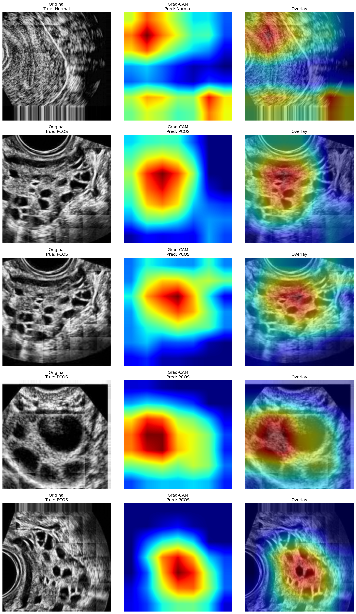

<!--
DRAFT NASKAH JUTIF: untuk dipindahkan ke JUTIF-Template.docx saat finalisasi.
Status      : Draf 4. Hasil E1–E6 terisi; audit near-duplicate, bootstrap CI,
              dan reframing ROI ovarium selesai; 28 referensi terverifikasi.
              Sisa: metadata penulis dan konversi DOCX.
Bahasa      : isi Indonesia (istilah asing yang belum baku ditulis miring);
              judul, abstrak, kata kunci Inggris (wajib JUTIF).
Konvensi penandaan:
  [FILL: ...] -> metadata yang masih menunggu masukan penulis
Sumber konten tunggal: references/kajian-literatur-gap-hipotesis.md
-->

# Impact of Wavelet Denoising and Unsupervised Ovarian ROI Generation on PCOS Classification from Ultrasound Images Using Attention-Based DenseNet-121

<!-- 18 kata, <= 20 kata JUTIF. Alternatif di outline jika ingin fokus G4. -->

**Nama Penulis 1\*, Nama Penulis 2**
_[FILL: nama tanpa gelar; tanda \* pada penulis korespondensi]_

_Department of Informatics, Jenderal Soedirman University, Indonesia_
Email: [FILL: email penulis korespondensi saja]

**Abstract.** Polycystic ovary syndrome (PCOS) classification from ultrasound images remains operator-dependent, and recent deep learning studies apply attention without isolating preprocessing effects or comparing attention mechanisms. This study measures the effect of wavelet denoising (BayesShrink) and unsupervised dark-region ovarian ROI generation on DenseNet-121 with attention, and compares self-attention against CBAM in accuracy and inference cost. Six configurations (E1–E6) were evaluated on the PCOS-XAI Ultrasound Dataset. After byte-identical deduplication, 3,996 unique images (3,184 PCOS, 812 healthy) were split 70/15/15 (2,797/599/600) with a fixed seed; the test set contains 479 PCOS and 121 healthy images. Accuracy, F1-score, specificity, and AUC were measured with bootstrap confidence intervals, complemented by a perceptual-hash near-duplicate audit and Grad-CAM inspection. Denoising raised accuracy from 97.67% (E1) to 98.17% (E2), although the paired interval includes zero. ROI cropping raised accuracy from 94.50% (E3) to 97.00% (E4) and F1 from 96.43% to 98.09%, while masked input performed best (98.67% accuracy, AUC 0.9980). CBAM used 35.6% fewer parameters (7.35 M vs 11.42 M) but was 0.67 percentage points less accurate and 17% slower on CPU, so the efficiency hypothesis was rejected. The audit found that 56.7% of test images have a perceptually close training neighbour against a 0.19% random-pair baseline; on the 157 least-similar images, accuracy remained between 96.2% and 98.1%, but the ROI advantage was no longer statistically separable. The results quantify preprocessing contributions that earlier PCOS studies did not isolate and show that fewer parameters do not imply lower inference cost.

**Keywords:** attention mechanism; CBAM; deep learning; ovarian ROI generation; polycystic ovary syndrome; ultrasound classification

---

## 1. Pendahuluan

Polycystic Ovary Syndrome (PCOS) adalah gangguan endokrin yang menyerang
sekitar 8–13% wanita usia reproduksi dan menjadi salah satu penyebab utama
infertilitas [1]. Diagnosisnya ditegakkan
berdasarkan kombinasi tanda klinis, laboratorium, dan pencitraan; kriteria
Rotterdam yang paling banyak dipakai mengandalkan oligo-ovulasi,
hiperandrogenisme, dan morfologi ovarium polikistik pada
ultrasonografi [2]. Pada praktik lapangan, USG
transvaginal menjadi pemeriksaan utama, tetapi kualitas interpretasinya
bergantung pada operator: citra yang sama dapat dibaca berbeda oleh sonografer
berbeda, dan struktur ovarium berukuran 2-9 mm mudah terlewat bila disiplin
teknik tidak konsisten [3]. Ketidakstabilan
ini menjadi kendala ketika PCOS harus disaring di layanan primer dengan
peralatan dan tenaga terbatas.

Klasifikasi berbasis _convolutional neural network_ (CNN) dapat mengurangi
ketergantungan tersebut. Dua karya terkini menunjukkan kelayakannya.
Tiwari, Shukla, & Sharma [4] membangun arsitektur ringan ber-attention dengan
empat backbone dan melaporkan akurasi 99.13% pada PCOS-XAI Ultrasound Dataset,
dengan DenseNet-121 + self-attention sebagai kombinasi terbaik; penulis
menutup dengan klaim kelayakan untuk skrining real-time dan _low-resource_.
Sundari dkk. [5] menggabungkan transfer learning dan _Bayesian Optimization_
pada backbone EfficientNet-B3 dan mencapai akurasi 94.8% dengan visualisasi
Grad-CAM sebagai lapis interpretabilitasnya.

Meski angka tersebut tinggi, kedua karya menyisakan tiga persoalan yang belum
diuji. _Pertama_, keduanya memakai satu varian attention tanpa membandingkan
antar mekanisme: Artikel 1 memasangkan self-attention dengan seluruh
backbone-nya, sedangkan Artikel 2 memakai satu modul attention yang tidak
dirinci variannya dan tanpa pembanding (G4). _Kedua_, klaim ringan pada
Artikel 1 tidak disertai pengukuran latensi, memori, atau uji perangkat,
sehingga klaim kelayakan low-resource tidak berdiri di atas bukti terukur
(G5).
_Ketiga_, Artikel 1 menerapkan denoising wavelet BayesShrink pada seluruh
citra tanpa melakukan ablation denoising-vs-non-denoising, sehingga
kontribusi preprocessing tersebut terhadap akurasi tidak bisa dibaca dari
artikelnya. Keterbatasan lain, yaitu fusi multimodal yang dideskripsikan tetapi
tidak dievaluasi (G1), tanpa validasi silang antar dataset (G2), dan tanpa
kuantifikasi ketidakpastian (G3), dicatat namun berada di luar scope
penelitian ini karena menuntut data berpasangan dan replikasi lintas
institusi. Penelitian ini mengambil G4 sebagai gap utama dengan sisa unsur
G5 melalui pengukuran parameter dan latensi, ditambah pertanyaan ablasi
preprocessing.

Tujuan penelitian dirumuskan dalam tiga pertanyaan yang saling terkait:

1. Seberapa besar pengaruh _wavelet denoising_ (BayesShrink) terhadap kualitas
   citra USG ovarium dan performa klasifikasi?
2. Apakah input dari ROI ovarium yang dibangkitkan secara unsupervised
   (ROI ter-crop atau citra ber-mask) meningkatkan kinerja klasifikasi
   dibanding citra penuh?
3. Mekanisme attention mana yang memberi trade-off lebih baik antara
   akurasi dan efisiensi: self-attention atau CBAM?

Untuk menjawabnya, penelitian ini merancang matriks enam eksperimen (E1–E6)
di atas DenseNet-121 + attention pada dataset raw yang sudah dibersihkan
dedup, ditambah audit kemiripan perseptual untuk menguji ketahanan hasil
terhadap near-duplicate yang lolos deduplikasi byte. Tiga pertanyaan tersebut
dijawab melalui pasangan eksperimen dengan kriteria keberhasilan yang
prespecified dan diuraikan pada Subbab 3.6.

## 2. Studi Terkait Klasifikasi PCOS dari Citra Ultrasonografi

Table 1 merangkum dua studi terdekat dan celah metodologis yang tersisa dari
keduanya. Studi lain memperluas bukti bahwa USG ovarium dapat
diklasifikasikan secara otomatis [6], [7], [8]; perbandingan terarah tetap
dibatasi pada dua studi terdekat karena keduanya paling dekat pada dataset
dan pertanyaan attention yang diuji di sini.

**Table 1. Perbandingan studi terkait PCOS dari citra ultrasonografi.**

| Studi            | Metode                                                                     | Preprocessing                                     | Attention                  | Ablasi                 | Dataset                               | Validasi eksternal | Pengukuran efisiensi     |
| ---------------- | -------------------------------------------------------------------------- | ------------------------------------------------- | -------------------------- | ---------------------- | ------------------------------------- | ------------------ | ------------------------ |
| Tiwari dkk. [4]  | 4 backbone (kustom, VGG19, DenseNet-121, EfficientNet-B0) + self-attention | BayesShrink + Gaussian smoothing (tanpa ablation) | Self-attention             | Backbone saja          | PCOS-XAI, 11.784 citra                | Tidak ada          | Tidak ada latensi/memori |
| Sundari dkk. [5] | Enhanced EfficientNet-B3 + attention, Bayesian Optimization                | Segmentasi sederhana + SMOTE pada fitur klinis    | Satu varian, tidak dirinci | Attention + augmentasi | PCOSGen (~3.200 citra) + fitur klinis | Tidak ada          | Tidak ada                |

Kedua artikel berhenti pada satu varian attention, tanpa ablation
preprocessing, dan tanpa pengukuran deployment. Keduanya juga mencatat
keterbatasan yang serupa: validasi hanya internal pada satu dataset, dan
laporan hanya memuat metrik _point-estimate_ tanpa interval kepercayaan
maupun kuantifikasi ketidakpastian. Penelitian ini menangani tiga hal yang
dapat dikerjakan tuntas dengan sumber daya yang ada: mengablasi efek
BayesShrink, menguji fokus area ovarium eksplisit lewat pembangkitan ROI
unsupervised, dan membandingkan dua mekanisme attention dengan pengukuran
latensi. Tiga persoalan yang tidak terjawab (multimodal, cross-dataset, dan
ketidakpastian) dinyatakan eksplisit sebagai batasan dan arah lanjutan.

## 3. Metode: Pipeline Klasifikasi PCOS Berbasis ROI Ovarium dengan Attention

Secara runtut, citra USG melewati: deduplikasi → preprocessing (resize,
opsional CLAHE, opsional BayesShrink) → pembangkitan mask kandidat area
gelap secara unsupervised dan konversi ke salah satu mode input →
DenseNet-121 + modul attention terpilih → evaluasi metrik, audit kemiripan,
dan Grad-CAM. Seluruh komponen diuraikan pada Subbab 3.1 sampai 3.5,
sedangkan desain eksperimen dan hipotesis pada Subbab 3.6.

### 3.1. Dataset dan Deduplikasi

Dataset yang dipakai adalah PCOS-XAI Ultrasound Dataset dari Kaggle [9]
dengan 11.784 citra mentah: 6.784 PCOS dan 5.000 sehat. Dataset ini memuat
persoalan dunia nyata seperti resolusi campuran, duplikasi byte-level, dan
ketimpangan kelas, namun tidak menyediakan mask ground-truth ovarium maupun
struktur ovarium, serta tidak menyediakan metadata pasien yang memungkinkan split level
pasien.

Sebelum split, salinan byte-identik dibuang dengan hashing md5 (strategi
_keep-first_) karena split acak level citra bisa menempatkan salinan yang
sama pada train sekaligus test dan menggelembungkan metrik secara artifisial.
Urgensi deduplikasi terbukti pada replikasi awal tanpa dedup: 81% citra
test set memiliki salinan identik di train, sehingga metrik yang sangat
tinggi (mis. akurasi 99.72%) merupakan tanda kebocoran data [dibahas pada
Subbab 4.5]. Hasil dedup:
3.996 citra unik (3.184 PCOS dan 812 sehat) tanpa salinan byte-identik
lintas kelas, seperti disajikan pada Table 2. Split 70/15/15 dengan seed 42
menghasilkan
2.797 citra latih, 599 validasi, dan 600 uji (479 PCOS, 121 sehat); total
7.788 salinan identik dihapus. Deduplikasi md5 hanya menangani salinan
byte-identik; kemiripan perseptual yang tersisa diukur pada Subbab 4.5.
Konsekuensinya rasio kelas menjadi 4:1,
sehingga akurasi saja menyesatkan; spesifisitas, F1, dan AUC harus dilaporkan
bersamaan, dan ketimpangan ini ditangani secara prespecified di semua
eksperimen lewat pos-weighted BCE (Subbab 3.5) tanpa resampling data.

**Table 2. Distribusi dataset sebelum dan sesudah deduplikasi.**

| Kelompok                    | PCOS  | Sehat | Total  |
| --------------------------- | ----- | ----- | ------ |
| Mentah (pra-dedup)          | 6.784 | 5.000 | 11.784 |
| Unik (pasca-dedup, dipakai) | 3.184 | 812   | 3.996  |

### 3.2. Pipeline Pemrosesan Awal

Citra di-resize ke 224×224 dan dinormalisasi ke rentang [0, 1]. Tahap
pemrosesan awal dipilih karena variasi kontras dan kualitas akuisisi dapat
menggeser performa pengklasifikasi citra medis [10]. Sesuai konfigurasi
eksperimen, tahap berikut bisa menambahkan CLAHE (_contrast limited adaptive
histogram equalization_) [11] dan/atau wavelet denoising
BayesShrink [12], [13]. Gambar 1 mengilustrasikan alur end-to-end dari tahap
pemrosesan awal hingga evaluasi model.

**Gambar 1. Diagram alur sistem klasifikasi PCOS berbasis DenseNet-121 dengan prapemrosesan wavelet, pembangkitan ROI ovarium unsupervised, dan mekanisme attention.**

Denoising wavelet menerapkan soft thresholding pada koefisien detail setiap
subband. Varian noise diestimasi dari subband HH level terhalus (HH1) melalui
_median absolute deviation_ pada Persamaan (1):

σ̂ = median(|w ∈ HH|) / 0.6745 (1)

Ambang adaptif tiap subband j dihitung dari varian noise dan estimasi varian
sinyal subband tersebut. Estimasi standar deviasi sinyal dinyatakan pada
Persamaan (2), dan ambang subband pada Persamaan (3):

σ̂\_{x,j} = √(max(mean(w_j²) − σ̂², 0)) (2)

T_j = σ̂² / σ̂\_{x,j} (3)

dengan w_j koefisien detail subband j, σ̂ estimasi standar deviasi noise dari
subband HH1, dan σ̂\_{x,j} estimasi standar deviasi sinyal pada subband j.
Nilai max(·, 0) mencegah varian negatif pada subband yang didominasi noise,
dan implementasi memberi lantai 1e-10 pada σ̂\_{x,j} agar pembagian tetap
terdefinisi. Momen kedua mean(w_j²) dipakai sebagai aproksimasi varian karena
koefisien detail subband hampir bermean nol; selisihnya kecil untuk citra USG
yang telah dinormalisasi.

Dua metrik deskriptif sisi pengolahan citra menyertai tahap ini:
_peak signal-to-noise ratio_ (PSNR) dan _structural similarity_
(SSIM) [14], dihitung untuk citra denoised terhadap citra raw. Karena
dataset tidak memiliki citra bersih ground-truth, keduanya mengukur seberapa
besar citra berubah akibat denoising, bukan seberapa baik kualitas citra
tersebut, sehingga dilaporkan sebagai bukti deskriptif sisi PCD dan bukan
penentu verdict hipotesis (kriteria verdict pada Subbab 3.6).

### 3.3. Pembangkitan ROI Ovarium Unsupervised dan Mode Input

Berbeda dari studi pendahulu yang mengandalkan attention sebagai mekanisme
fokus, penelitian ini menguji fokus eksplisit lewat mask kandidat area gelap
sebagai tahap prapemrosesan. Mask dibangun dengan
pendekatan unsupervised: threshold Otsu [15] atau adaptif pada citra
grayscale, diikuti operasi morfologi (opening, closing, filling holes),
pembuangan komponen yang menyentuh batas citra, dan penyaringan region
dengan luas minimum 80 piksel. Jika Otsu menangkap background sebagai objek,
yang ditandai coverage mask melebihi 50%, sistem berfallback ke threshold
persentil gelap ke-15. Mask dihitung pada kanvas kerja 224×224 agar ambang
piksel konsisten antar resolusi, lalu di-upscale ke ukuran asli.

Perlu ditegaskan bahwa prosedur ini adalah detektor area gelap, bukan
detektor area gelap. Folikel USG tampak hipoekoik, tetapi background
dan bayangan akustik juga gelap, sehingga mask dapat mencakup area di luar
ovarium. Karena dataset tidak menyediakan mask ground-truth, tidak ada
klaim bahwa mask berkorespondensi satu-satu dengan ROI ovarium; Subbab 4.1 dan
4.2 menunjukkan bahwa mask lebih tepat dibaca sebagai pembatas area
gelap/ovarium yang menekan background.

Tiga mode input membedakan seberapa kuat fokus eksplisit itu diberikan:
**full** (citra penuh tanpa modifikasi spatial), **roi** (_crop_ ke bounding
box gabungan seluruh region mask ditambah padding 8 piksel lalu di-resize
kembali), dan **masked** (citra penuh, area di luar mask digelapkan).
Opsi-opsi tersebut dirangkum pada Table 3; ketiganya dilatih dengan split
dan seed yang sama agar perbandingan setara.

**Table 3. Mode input hasil pembangkitan ROI.**

| Mode   | Sumber piksel                                               | Efek pada model                                     |
| ------ | ----------------------------------------------------------- | --------------------------------------------------- |
| full   | Citra penuh                                                 | Model mempelajari citra plus background aslinya     |
| roi    | Bounding box gabungan mask + padding 8 px, di-resize ke 224 | Zoom ke area gelap kandidat ovarium                 |
| masked | Citra penuh dengan area di luar mask digelapkan             | Proporsi asli dipertahankan, background dieliminasi |

Pada mode masked, intensitas piksel di luar area mask segmentasi dinolkan
(diberikan nilai nol atau latar belakang hitam) tanpa mengubah ukuran spasial
maupun proporsi anatomi citra asli.

### 3.4. Arsitektur Attention dan Backbone

Backbone utama adalah DenseNet-121 [16] pralatih ImageNet. Transfer learning
dengan backbone pralatih lazim dipakai pada klasifikasi citra medis [17], dan
DenseNet-121 dipilih di antara arsitektur CNN dalam seperti keluarga residual
[18] karena konektivitas dense-nya menjaga aliran gradien pada data terbatas.
Di atas backbone dipasang head fully-connected dengan dropout 0.3.

Empat varian modul attention dibandingkan, semuanya ditempatkan pada peta
fitur sebelum pooling global. Model dengan self-attention (11.4 juta
parameter total) [4] memakai proyeksi Q, K, V multi-head pada token spasial.
Token fitur spasial berdimensi (B, H·W, C), sehingga untuk input 224 piksel
dengan H = W = 7 terdapat N = 49 token. Perhitungan attention mengikuti
Persamaan (4):

Attention(Q, K, V) = softmax(QKᵀ / √d_k) · V (4)

Modul ini dipasang pada token spasial 7×7 sebelum pooling. Model dengan CBAM
(7.3 juta parameter total) [19] menerapkan channel attention lalu spatial
attention secara berturut-turut pada peta fitur (B, C, H, W). SE-Net
(7.3 juta parameter total) [20] hanya memakai attention kanal dan tidak
dimasukkan ke matriks eksperimen utama. Transformer-attention (32.4 juta
parameter total) [21] berbasis patch token dan berada di luar scope utama
karena bobotnya jauh lebih besar serta tidak lolos klaim ringan yang diuji
H3.

Untuk perbandingan antar mekanisme attention hanya dua kandidat yang
diangkat: self-attention (replikasi Artikel 1) dan CBAM (kandidat ringan yang
memberi spatial attention relevan dengan area ovarium). Kedua mekanisme attention
ini diintegrasikan ke dalam arsitektur DenseNet-121 untuk mengevaluasi
trade-off antara akurasi klasifikasi, jumlah parameter, dan latensi inferensi.
Sebagai pembanding efisiensi di tingkat backbone, MobileNetV2 menunjukkan
bahwa inverted residual dan linear bottleneck dapat menekan biaya komputasi
tanpa mengorbankan akurasi secara berarti [22].

### 3.5. Protokol Pelatihan dan Penanganan Ketimpangan Kelas

Pelatihan memakai Adam (learning rate 1e-4, weight decay 1e-4), batch size
64, dan _automatic mixed precision_ untuk mempercepat pelatihan di Colab T4
(±10 GB VRAM, estimasi 50–60 menit per run 30 epoch). Early stopping
patience 10; scheduler ReduceLROnPlateau. Augmentasi pada split train:
rotasi acak hingga 15°, flip horizontal, dan RandomResizedCrop [23],
[24].
Split 70/15/15 dengan seed 42 untuk split, shuffle, augmentasi, dan
inisialisasi model, sehingga semua eksperimen sebanding dan reprodusibel.

Ketimpangan kelas 4:1 ditangani dengan pos_weight pada
BCEWithLogitsLoss. Variabel w di Persamaan (5) di-set ke rasio
n_negatif/n_positif yang dihitung hanya dari split train:

ℓ = (1/N) Σ [ −w · yᵢ · log pᵢ − (1−yᵢ) · log(1−pᵢ) ] (5)

dengan yᵢ biner label kelas positif (PCOS) dan pᵢ peluang prediksi. Pendekatan
ini menyeimbangkan gradien kedua kelas tanpa mengubah distribusi data,
berbeda dari resampling, SMOTE, atau augmentasi berlebih yang dapat
memperbesar risiko overfitting pada kelas minoritas [25]. Nilai pembobot w
yang diperoleh dari rasio data latih adalah 0.2509 dan diterapkan secara
seragam pada seluruh eksperimen.

### 3.6. Hipotesis, Matriks Eksperimen, dan Metrik Evaluasi

Hipotesis dirumuskan sebagai pasangan H0/H1 dengan kriteria keberhasilan
yang ditetapkan sebelum evaluasi. Verdict utama tetap deskriptif mengikuti
aturan tersebut. Karena desain hanya memakai satu split dan satu run, uji
signifikansi formal untuk generalisasi lintas pelatihan tidak dapat
dilakukan; sebagai analisis sekunder, ketidakpastian sampling test diukur
dengan bootstrap dan McNemar, dan hasilnya tidak mengubah verdict
prespecified. Table 4 memetakan enam konfigurasi eksperimen ke hipotesis.

**Table 4. Matriks eksperimen E1–E6 dan pemetaan hipotesis.**

| ID  | Preprocessing       | Segmentasi/ROI | Attention      | Menguji         |
| --- | ------------------- | -------------- | -------------- | --------------- |
| E1  | baseline            | full           | self-attention | baseline H1     |
| E2  | BayesShrink         | full           | self-attention | H1              |
| E3  | BayesShrink + CLAHE | full           | self-attention | baseline H2     |
| E4  | BayesShrink + CLAHE | otsu / roi     | self-attention | H2, baseline H3 |
| E5  | BayesShrink + CLAHE | otsu / masked  | self-attention | H2 (deskriptif) |
| E6  | BayesShrink + CLAHE | otsu / roi     | cbam           | H3              |

Kriteria keberhasilan setiap hipotesis ditetapkan sebelum eksperimen
dievaluasi agar penilaian tidak bergantung pada hasil yang teramati. H1
(denoising) diterima bila akurasi atau AUC E2 lebih tinggi secara ketat dari
E1 pada minimal satu metrik tanpa regresi lebih dari 0.005 pada metrik
satunya; hasil identik tidak dihitung diterima. H2 (pembangkitan ROI) memakai
E4 (ROI crop Otsu) sebagai varian utama dengan AUC sebagai metrik utama, dan
diterima bila AUC E4 > E3 serta F1 E4 tidak lebih buruk melebihi 0.005. E5
(masked) dilaporkan sebagai pembanding sekunder dan tidak menentukan verdict,
sehingga tidak ada pemilihan varian terbaik di atas test set. H3 (efisiensi
attention) diterima bila akurasi dan AUC E6 tidak turun lebih dari 0.005 dari
E4, jumlah parameter lebih sedikit, dan latensi tidak lebih besar. Toleransi
0.005 berada dekat rentang noise run-to-run pada satu seed; konsekuensinya
dimuat sebagai batasan pada Subbab 4.7. Karena AUC pada dataset ini mendekati
plafon, akurasi dan F1 tetap dilaporkan sebagai metrik pendamping dan dipakai
untuk menilai kekuatan bukti, tanpa mengubah kriteria verdict.

Metrik evaluasi sisi klasifikasi meliputi accuracy, precision, recall,
F1-score, specificity, dan AUC, dilengkapi confusion matrix dan kurva ROC.
Karena H3 mencakup dimensi efisiensi komputasi, jumlah parameter model dan
latensi inferensi pada prosesor CPU (dalam milidetik per sampel) turut
diukur. Latensi diukur terpisah dari preprocessing: setiap model dibangun
tanpa bobot pralatih, diuji pada input acak berukuran batch 1 × 3 × 224 × 224,
dipanaskan dengan 3 forward, lalu diukur dalam 5 putaran yang masing-masing
memuat 20 forward secara bergantian antar model. Angka yang dilaporkan adalah
median dari 5 putaran; pengukuran bergantian mengurangi bias kondisi CPU.
Identitas CPU dan jumlah thread tidak tersimpan pada artefak yang
dipublikasikan, sehingga angka latensi hanya sah dibandingkan antar model
pada sesi pengukuran yang sama, bukan sebagai benchmark perangkat.

Evaluasi sisi pengolahan citra (PSNR, SSIM, serta statistik ROI yang
mencakup jumlah region, cakupan area, luas rata-rata, dan luas maksimum) dan
visualisasi overlay mask dijalankan secara deterministik pada tahap
prapemrosesan, sehingga bebas dari variabilitas pelatihan model. Keputusan
akhir H1–H3 ditarik dari aturan kuantitatif yang telah ditentukan.

Interval kepercayaan 95% dihitung dengan bootstrap persentil dari 5.000
resample pada level citra uji. Untuk selisih pasangan, resample yang sama
diterapkan pada kedua model agar korelasinya terjaga. Uji McNemar eksak
dipakai pada pasangan prediksi yang discordant. Prosedur ini hanya menangkap
variabilitas sampling test set, bukan variabilitas inisialisasi atau
pelatihan, sehingga CI tidak boleh dibaca sebagai bukti replikasi. Audit
near-duplicate memakai perceptual hash 64-bit (grayscale 32×32, DCT dua
dimensi, 8×8 koefisien frekuensi rendah, median sebagai ambang) dan jarak
Hamming minimum setiap citra uji ke seluruh citra latih, lalu dibandingkan
dengan baseline pasangan acak; prosedur dan hasilnya diuraikan pada
Subbab 4.5.

Empat batasan desain yang disebut sejak awal: (a) tidak ada mask
ground-truth, sehingga mask berperan sebagai pembatas area gelap/penyedia ROI
dan bukan pengukuran Dice klinis; (b) satu seed dan satu run per eksperimen,
sehingga perbandingan bersifat deskriptif; (c) split level citra, bukan
pasien/video, sehingga frame berurutan dari perekaman yang sama bisa nyaris
identik meski lolos md5; (d) kuota komputasi Colab membatasi replikasi
multi-seed.

## 4. Hasil dan Pembahasan

Seluruh metrik performa yang dilaporkan pada bab ini diperoleh dari pengujian
pada 600 citra uji yang tidak dipakai saat pelatihan. Setiap konfigurasi
eksperimen dilatih menggunakan seed pengacakan tetap (seed 42) pada
akselerator GPU Tesla T4. Subset ini bukan test set independen secara ketat:
audit pada Subbab 4.5 menunjukkan bahwa sebagian besar citra uji memiliki
tetangga perseptual di split latih. Test set berisi 479 PCOS dan 121 citra
sehat, sehingga satu kesalahan klasifikasi setara dengan 0.17 poin
persentase akurasi.

### 4.1. Denoising terhadap Kualitas Citra dan Klasifikasi (E1 vs E2)

Table 5 merangkum metrik kualitas pada 100 citra per kelas. BayesShrink
mengubah citra secara minimal: PSNR 50.35 ± 1.95 dB pada kelas PCOS dan
52.07 ± 1.08 dB pada kelas sehat, dengan SSIM 0.996 di kedua kelas.
Sebaliknya, CLAHE mengubah histogram secara agresif: PSNR turun ke
17.05 ± 1.18 dB (PCOS) dan 17.59 ± 1.50 dB (sehat), meski SSIM masih berada
pada rentang 0.74–0.77. Segmentasi Otsu menghasilkan rata-rata 10.2 region
per citra, dengan coverage 28.49% pada kelas PCOS dan 38.53% pada kelas
sehat; Gambar 2 memperlihatkan overlay mask pada satu citra per kelas.
Pola coverage ini penting untuk interpretasi. Kelas sehat justru memiliki
coverage lebih besar dan luas region maksimum hampir dua kali lipat
(14.425 vs 7.614 piksel). Jika mask menangkap region gelap/ovarium, arahnya seharusnya
berlawanan karena ovarium PCOS umumnya memuat struktur gelap lebih banyak [3].
Gambar 2 juga memperlihatkan mask yang mencakup background gelap dan tepi
citra, terutama pada sampel sehat. Mask karena itu dibaca sebagai pembatas
area gelap/ovarium, bukan delineasi folikel.

Pada sisi klasifikasi, denoising meningkatkan performa secara konsisten
namun kecil: akurasi E2 98.17% berbanding E1 97.67% (+0.50 poin persentase),
AUC 0.9976 berbanding 0.9968 (+0.0008), dan F1 98.84% berbanding 98.52%;
spesifisitas tetap 100% pada keduanya. Kriteria H1 mensyaratkan E2 lebih
tinggi ketat pada akurasi atau AUC tanpa regresi melebihi 0.005 pada metrik
lainnya; kedua syarat tersebut terpenuhi, sehingga **H1 diterima**. Bukti
ini lemah secara statistik: selisih akurasi +0.51 poin persentase memiliki
95% CI [−0.50, +1.67] dan uji McNemar pada prediksi discordant memberi
p = 0.55. Verdict dipertahankan karena aturan prespecified, bukan karena
selisihnya terpisah dari noise.

Perubahan citra yang kecil sejalan dengan manfaat yang kecil. BayesShrink
hanya mengubah citra pada tingkat PSNR ±51 dB, yang berarti perubahan
strukturalnya sedikit, dan keuntungan akurasinya pun kecil. Ini konsisten
dengan citra yang secara visual sudah cukup bersih. CLAHE memperlihatkan pola
berlawanan: meskipun lazim disebut peningkatan kontras, PSNR rendah
menandakan perubahan piksel yang besar, dan E3 (E2 + CLAHE) turun ke akurasi
94.50% (-3.67 poin dibanding E2) walaupun AUC tetap 0.9970. Perbaikan kontras
yang agresif memperkuat speckle dan menggeser distribusi skor di sekitar
ambang keputusan, sehingga akurasi turun sementara kualitas pemeringkatan
(AUC) relatif terjaga. Temuan ini juga menunjukkan bahwa PSNR/SSIM tidak
dapat dijadikan penentu verdict: keduanya hanya mengukur besar perubahan,
bukan manfaat diskriminatif.

**Table 5. Metrik kualitas sisi pemrosesan citra dan statistik ROI per kelas
(n = 100 per kelas).**

| Metrik                     | PCOS (mean ± std) | Sehat (mean ± std) |
| -------------------------- | ----------------- | ------------------ |
| PSNR denoised (dB)         | 50.35 ± 1.95      | 52.07 ± 1.08       |
| SSIM denoised              | 0.9959 ± 0.0026   | 0.9967 ± 0.0022    |
| PSNR CLAHE (dB)            | 17.05 ± 1.18      | 17.59 ± 1.50       |
| SSIM CLAHE                 | 0.7386 ± 0.0395   | 0.7735 ± 0.0465    |
| Region Otsu (jumlah)       | 10.11 ± 5.23      | 10.36 ± 4.73       |
| Coverage Otsu (%)          | 28.49 ± 17.37     | 38.53 ± 10.59      |
| Luas region rata-rata (px) | 1624.07 ± 1609.38 | 2114.35 ± 1234.11  |
| Luas region maksimum (px)  | 7613.99 ± 6068.78 | 14425.13 ± 5342.91 |

**Gambar 2. Contoh keluaran prapemrosesan pada satu citra per kelas (kiri ke kanan: citra asli, denoised BayesShrink, CLAHE, dan overlay mask Otsu): (a) kelas PCOS dan (b) kelas kontrol sehat.**

### 4.2. Pembangkitan ROI Ovarium terhadap Klasifikasi (E3 vs E4 vs E5)

Verdict H2 diuji melalui E4 (ROI crop Otsu) sebagai varian prespecified
dibanding E3. AUC E4 0.9971 hanya 0.0001 lebih tinggi dari E3 0.9970, tetapi
F1 naik dari 96.43% ke 98.09% (+1.66 poin) dan akurasi dari 94.50% ke
97.00%; karena AUC tetap lebih tinggi dan F1 tidak mengalami regresi
melebihi 0.005, **H2 diterima** secara formal. AUC sendiri tidak informatif:
selisihnya memiliki 95% CI [−0.0008, +0.0013]. Bukti H2 berasal dari
akurasi (+2.51 poin persentase, CI [0.67, 4.33]) dan F1 (+1.66 poin,
CI [0.44, 2.89]), dengan McNemar p = 0.011 pada prediksi discordant.
E5 (masked), yang dilaporkan sebagai pembanding deskriptif dan tidak
menentukan verdict, mencapai performa tertinggi: akurasi 98.67%,
F1 99.16%, dan AUC 0.9980, dengan spesifisitas 97.52% (3 dari 121 citra
sehat salah diklasifikasi). Dibanding E4, E5 menambah akurasi +1.69 poin
persentase (CI [0.33, 3.17]) dan F1 +1.09 poin (CI [0.22, 2.09]);
McNemar p = 0.0414.

Pola ini lebih tepat dibaca sebagai efek pemusatan area ovarium dan
penekanan background daripada sebagai bukti deteksi ROI ovarium. E3 adalah
kondisi terburuk (94.50%) karena CLAHE memperkuat speckle tanpa
menghilangkan background; ROI crop memulihkan performa ke 97.00% dengan
memusatkan resolusi 224×224 pada area gelap kandidat ovarium, sedangkan
masked input memberi keuntungan terbesar (98.67%) karena mempertahankan
proporsi anatomi sekaligus menekan background. Konsekuensi masked adalah
munculnya tiga false positive, yang menjelaskan spesifisitas 97.52%.
Trade-off ini konsisten dengan komposisi test set yang hanya memuat 121 citra
sehat (20.2%). Table 6 merangkum keenam konfigurasi secara berdampingan.
Artikel 1 mengandalkan attention implisit untuk fokus pada area ovarium,
sedangkan Artikel 2 memakai Grad-CAM sebagai lapis interpretabilitas [4], [5];
hasil di sini menunjukkan bahwa pembatasan area secara eksplisit
memberi manfaat terukur pada test set ini, tetapi audit pada Subbab 4.5
memperlihatkan bahwa besarnya manfaat menyusut pada citra uji yang tidak
memiliki tetangga dekat di split latih.

**Table 6. Hasil klasifikasi enam eksperimen pada test set (n = 600).**

| ID  | Preprocessing       | Segmentasi/ROI | Attention      | Acc (%) | Prec (%) | Recall (%) | F1 (%) | Spec (%) | AUC    | Param (M) | Lat. (ms CPU) |
| --- | ------------------- | -------------- | -------------- | ------- | -------- | ---------- | ------ | -------- | ------ | --------- | ------------- |
| E1  | baseline            | full           | self-attention | 97.67   | 100.00   | 97.08      | 98.52  | 100.00   | 0.9968 | 11.42     | 138.86        |
| E2  | BayesShrink         | full           | self-attention | 98.17   | 100.00   | 97.70      | 98.84  | 100.00   | 0.9976 | 11.42     | 114.08        |
| E3  | BayesShrink + CLAHE | full           | self-attention | 94.50   | 100.00   | 93.11      | 96.43  | 100.00   | 0.9970 | 11.42     | 114.36        |
| E4  | BayesShrink + CLAHE | roi            | self-attention | 97.00   | 100.00   | 96.24      | 98.09  | 100.00   | 0.9971 | 11.42     | 128.93        |
| E5  | BayesShrink + CLAHE | masked         | self-attention | 98.67   | 99.37    | 98.96      | 99.16  | 97.52    | 0.9980 | 11.42     | 119.95        |
| E6  | BayesShrink + CLAHE | roi            | cbam           | 96.33   | 100.00   | 95.41      | 97.65  | 100.00   | 0.9965 | 7.35      | 150.87        |

**Gambar 3. Kurva ROC dan matriks konfusi konfigurasi utama: (a) kurva ROC E4 (ROI crop), (b) matriks konfusi E4, (c) kurva ROC E5 (masked input), dan (d) matriks konfusi E5.**

### 4.3. Perbandingan Mekanisme Attention (E4 vs E6)

Verdict H3 diuji dengan membandingkan E6 (CBAM) terhadap E4 (self-attention)
pada preprocessing dan mode input yang sama. E6 memakai 7.35 juta parameter,
35.6% lebih sedikit daripada 11.42 juta pada E4. Namun E6 hanya mencapai
akurasi 96.33% (vs 97.00%) dan AUC 0.9965 (vs 0.9971), dengan latensi CPU
150.87 ms (vs 128.93 ms, +17.0%). Selisih akurasi −0.67 poin persentase
memiliki 95% CI [−2.17, +0.83] dan McNemar p = 0.50, sedangkan selisih AUC
−0.0006 memiliki CI [−0.0023, +0.0007]; keduanya mencakup nol. Secara titik,
penurunan akurasi 0.0067 melewati toleransi 0.005, tetapi bukti yang tegas
adalah latensi: E6 lebih lambat 17.0%. Kriteria H3 menuntut akurasi dan AUC
tidak turun lebih dari 0.005, parameter lebih sedikit, dan latensi tidak
lebih besar; karena syarat latensi gagal dan penurunan akurasi di atas
toleransi, **H3 ditolak**. Penolakan ini bertumpu pada biaya inferensi,
bukan pada klaim bahwa CBAM secara signifikan lebih rendah akurasinya.

Hasil ini menunjukkan bahwa jumlah parameter yang lebih kecil tidak otomatis
menurunkan biaya inferensi. Survei mekanisme attention menunjukkan bahwa tidak
ada satu varian yang unggul di semua tugas, sehingga perbandingan harus
diikat pada konteks arsitektur dan perangkat [26]. CBAM menambahkan dua tahap
gating berurutan, yaitu channel attention lalu spatial attention, pada peta
fitur akhir sebelum pooling. Pada CPU, rangkaian operasi tersebut lebih mahal
daripada proyeksi Q/K/V self-attention yang berjalan pada 49 token. Parameter
dan latensi adalah dua sumbu efisiensi yang berbeda; klaim arsitektur ringan
pada Artikel 1 [4] tanpa pengukuran latensi tidak cukup untuk menyimpulkan
kesiapan low-resource. Table 7 merangkum keputusan ketiga hipotesis beserta
kriterianya.

**Table 7. Ringkasan keputusan evaluasi hipotesis penelitian.**

| Hipotesis | Perbandingan | Kriteria                                                                         | Verdict        |
| --------- | ------------ | -------------------------------------------------------------------------------- | -------------- |
| H1        | E2 vs E1     | akurasi/AUC lebih tinggi ketat tanpa regresi > 0.005                             | diterima       |
| H2        | E4 vs E3     | AUC lebih tinggi dan F1 tidak turun > 0.005                                      | diterima       |
| H3        | E6 vs E4     | akurasi dan AUC ≥ E4 − 0.005, parameter lebih sedikit, latensi tidak lebih besar | tidak diterima |

### 4.4. Interpretasi Kualitatif dengan Grad-CAM

Gambar 4 menampilkan heatmap Grad-CAM [27] dari E4 untuk lima citra uji
pertama. Kelimanya kebetulan terklasifikasi benar, tetapi pemilihan sampel
tidak didasarkan pada kebenaran prediksi, kelas, maupun tingkat kesulitan;
figure ini karena itu bukan sampel representatif. Grad-CAM adalah metode
penjelasan pasca-hoc [28], dan peta fitur terakhir DenseNet-121 pada input
224×224 berukuran 7×7, sehingga satu sel heatmap mewakili area 32×32 piksel.
Resolusi tersebut tidak cukup untuk menempatkan struktur gelap berukuran
2–9 mm [3].

Pada Gambar 4, aktivasi E4 membentuk blob kasar yang sebagian besar berada
di area ovarium, tetapi pada beberapa sampel massa aktivasi mencapai tepi
citra. Pola ini konsisten dengan model yang memakai informasi area ovarium
dan tekstur sekitarnya. Namun figure ini tidak membuktikan bahwa model
menghitung struktur ROI, tidak menunjukkan keselarasan kuantitatif dengan mask
Otsu, dan tidak menyingkirkan kemungkinan pemanfaatan artefak tepi, penanda
perangkat, atau korelasi dengan kelas. Karena hanya lima sampel diperiksa
dan tidak ada kuantifikasi korelasi heatmap terhadap mask, subbab ini
bersifat ilustratif dan tidak dipakai sebagai bukti H2.

**Gambar 4. Visualisasi heatmap Grad-CAM konfigurasi E4 pada lima citra uji pertama (citra asli, heatmap aktivasi, dan overlay aktivasi).**

### 4.5. Audit Kemiripan Perseptual dan Sensitivitas Hasil

Deduplikasi md5 pada Subbab 3.1 hanya membuang salinan byte-identik. Untuk
mengukur kebocoran yang tersisa, setiap citra uji dibandingkan dengan seluruh
citra latih memakai perceptual hash 64-bit: citra grayscale di-resize ke
32×32, ditransformasi _discrete cosine transform_ (DCT) dua dimensi, lalu
8×8 koefisien frekuensi rendah diambangkan terhadap mediannya. Jarak Hamming minimum ke citra latih
terdekat dihitung untuk setiap citra uji dan dibandingkan dengan baseline
pasangan acak. Split direkonstruksi dari urutan dataset, dedup keep-first,
dan randperm seed 42; metrik E1–E6 yang dihitung ulang dari split ini sama
dengan angka pada Table 6 sampai empat desimal, sehingga split yang diaudit
memang split yang dilaporkan.

**Table 8. Distribusi jarak Hamming minimum citra uji ke citra latih
terdekat (perceptual hash 64-bit, n = 600).**

| Jarak minimum      | Jumlah citra uji | Persentase | Baseline pasangan acak |
| ------------------ | ---------------- | ---------- | ---------------------- |
| ≤ 0 (hash identik) | 100              | 16.7%      | 0.02%                  |
| ≤ 2                | 212              | 35.3%      | 0.06%                  |
| ≤ 4                | 287              | 47.8%      | 0.12%                  |
| ≤ 6                | 340              | 56.7%      | 0.19%                  |
| ≤ 8                | 391              | 65.2%      | 0.28%                  |
| ≤ 10               | 443              | 73.8%      | 0.43%                  |

Table 8 menunjukkan pengayaan yang jauh di atas kebetulan: 56.7% citra uji
memiliki tetangga latih pada jarak ≤ 6, sedangkan pasangan acak hanya 0.19%;
pada jarak ≤ 10 angkanya 73.8% berbanding 0.43%. Median jarak pasangan acak
adalah 30. Sebanyak 100 citra uji bahkan memiliki hash identik dengan citra
latih. Pemeriksaan piksel pada 100 pasangan tersebut menemukan 13 pasangan
dengan _mean absolute error_ (MAE) < 1 dan 33 pasangan dengan korelasi > 0.99
setelah resize 128×128, sehingga sebagian memang citra yang sama dengan
re-encoding atau crop berbeda, sementara sebagian lain hanya berbagi struktur
frekuensi rendah.

Kemiripan ini tidak tersebar merata antar kelas. Median jarak terdekat
adalah 4 untuk citra uji PCOS dan 10 untuk citra sehat; 307 dari 479 citra
uji PCOS memiliki tetangga pada jarak ≤ 6, sedangkan pada kelas sehat hanya
33 dari 121. Ini berarti metrik recall dan akurasi keseluruhan lebih
berisiko terangkat daripada spesifisitas. Klaim bahwa test set independen
karena sudah dideduplikasi byte tidak dapat dipertahankan; yang benar adalah
test set bebas salinan byte-identik, tetapi tidak bebas near-duplicate
perseptual.

Untuk menguji ketahanan hasil, metrik dihitung ulang pada 157 citra uji
yang jarak terdekatnya > 10 (47 sehat dan 110 PCOS), yaitu subset yang
paling tidak mirip dengan split latih.

**Table 9. Metrik pada seluruh test set dan pada subset citra uji tanpa
tetangga latih berjarak ≤ 10.**

| ID  | Acc penuh (%) | F1 penuh (%) | AUC penuh | Acc bersih (%) | F1 bersih (%) | AUC bersih |
| --- | ------------- | ------------ | --------- | -------------- | ------------- | ---------- |
| E1  | 97.67         | 98.52        | 0.9968    | 97.45          | 98.15         | 0.9983     |
| E2  | 98.17         | 98.84        | 0.9976    | 98.09          | 98.62         | 0.9963     |
| E3  | 94.50         | 96.43        | 0.9970    | 96.18          | 97.20         | 0.9963     |
| E4  | 97.00         | 98.09        | 0.9971    | 96.82          | 97.67         | 0.9959     |
| E5  | 98.67         | 99.16        | 0.9980    | 98.09          | 98.62         | 0.9990     |
| E6  | 96.33         | 97.65        | 0.9965    | 96.18          | 97.20         | 0.9934     |

Pada subset bersih, performa tidak runtuh: akurasi tetap 96.18–98.09%.
Namun keunggulan yang dilaporkan pada seluruh test set menyusut. Selisih F1
E4−E3 turun dari +1.66 menjadi +0.47 poin, dan selisih AUC berubah dari
+0.0001 menjadi −0.0004; McNemar pada subset ini tidak signifikan (p = 1.00).
E5 juga tidak lagi unggul tunggal pada akurasi: E2 dan E5 sama-sama mencapai
98.09%. Perbandingan E5−E4 pada subset bersih tidak signifikan (McNemar
p = 0.63). Dengan ambang yang lebih ketat (> 12, n = 123), urutan berubah
lagi: E1 dan E2 mencapai akurasi 99.19%, sedangkan E5 98.37%. Subset
berukuran kecil (47 citra sehat) membuat interval lebar, sehingga hasil ini
tidak boleh dibaca sebagai bukti bahwa preprocessing tidak berguna. Yang
dapat disimpulkan adalah bahwa besarnya manfaat dan peringkat model pada
Table 6 bergantung pada komposisi near-duplicate test set dan tidak stabil
pada citra yang lebih independen.

Temuan ini mengubah status test set, bukan seluruh hasil. Performa tinggi
pada citra bersih menunjukkan bahwa model tidak sepenuhnya bergantung pada
near-duplicate, tetapi angka pada Table 6 harus dibaca sebagai batas atas
yang optimistis. Perbaikan yang paling menentukan adalah split berbasis klaster
near-duplicate, bukan sekadar deduplikasi byte, dan replikasi pada split
tersebut. Tanpa itu, perbandingan E3–E5 tetap merupakan perbandingan pada
benchmark yang sama, tetapi bukan estimasi performa pada populasi citra
baru.

### 4.6. Perbandingan dengan Studi Terdahulu

Konfigurasi terbaik pada penelitian ini, E5, mencapai akurasi 98.67% dan AUC
0.9980; E2 (denoising tanpa pembangkitan ROI) mencapai 98.17% dan AUC 0.9976.
Artikel 1 [4] melaporkan 99.13% pada dataset yang sama. Artikel tersebut
menyatakan bahwa dataset sengaja mempertahankan duplikasi, dengan lebih dari
1.956 kelompok duplikat, dan tidak melaporkan deduplikasi sebelum split.
Sebaliknya, penelitian ini membuang 7.788 salinan byte-identik dan masih
menemukan kemiripan perseptual yang tinggi (Subbab 4.5). Kedua angka karena
itu dihasilkan dari protokol evaluasi yang tidak sebanding, sehingga
selisihnya tidak dapat ditafsirkan sebagai keunggulan salah satu metode.
Angka 99.13% juga tidak disertai interval kepercayaan atau audit duplikasi,
sehingga tidak dapat dijadikan acuan tunggal. Selisih terhadap Artikel 2 [5]
tidak dapat ditafsirkan karena dataset dan komposisi kelasnya berbeda.

Yang dapat dibandingkan secara adil adalah baseline internal: E1 tanpa
denoising dan tanpa pembangkitan ROI mencapai 97.67%. Pada dataset ini tugas
klasifikasi mendekati plafon, sehingga ruang perbaikan yang tersedia hanya
beberapa poin persentase; efek denoising (+0.50 poin) dan pembangkitan ROI
(+1.66 poin F1 dari E3 ke E4 pada seluruh test set, +0.47 poin pada subset
bersih) karena itu lebih bermakna sebagai bukti peran preprocessing daripada
sebagai klaim keunggulan absolut. Penelitian ini juga melaporkan parameter
dan latensi CPU (114–151 ms) yang tidak disertakan Artikel 1 [4], sehingga
perbandingan efisiensi dapat dilakukan secara terbuka.

### 4.7. Batasan dan Ancaman Validitas

1. Kontrol duplikat utama hanya memakai hash byte-identik. Audit perceptual
   hash pada Subbab 4.5 menemukan bahwa 56.7% citra uji memiliki tetangga
   latih pada jarak Hamming ≤ 6, dan pengaruhnya lebih besar pada kelas PCOS.
   Split berbasis klaster near-duplicate, atau split level pasien bila
   metadata tersedia, adalah perbaikan paling penting berikutnya.
2. Eksperimen memakai satu seed, satu run, dan early stopping yang cepat.
   E4 dan E6 berhenti pada epoch terbaik ke-2, E3 pada epoch ke-7, sementara
   kurva validasi berfluktuasi; hasil satu run rentan terhadap variasi
   inisialisasi. Toleransi verdict 0.005 berada dekat rentang noise, dan
   bootstrap CI pada Subbab 4.1–4.3 hanya menangkap variabilitas sampling
   test, bukan variabilitas pelatihan. Replikasi multi-seed (minimum tiga)
   perlu dijadwalkan.
3. Test set berukuran kecil (600 citra: 479 PCOS, 121 sehat). Satu kesalahan
   setara dengan 0.17 poin akurasi. Margin AUC H2 (0.0001) jauh lebih kecil
   dari perubahan yang dapat dipicu variasi satu run, sehingga verdict H2
   bertumpu pada selisih F1 (+1.66 poin pada seluruh test set), bukan pada
   AUC, dan selisih itu menyusut menjadi +0.47 poin pada subset bersih.
4. Ketimpangan kelas 4:1 membuat akurasi murni menyesatkan; karena itu
   specificity, F1, dan AUC dilaporkan bersamaan.
5. Mask tidak memiliki ground-truth dan secara konstruksi adalah detektor
   area gelap, bukan segmentasi folikel. Kualitas mask hanya dinilai secara
   kualitatif dan melalui statistik ROI; tidak ada metrik Dice klinis, dan
   arah coverage antar kelas tidak konsisten dengan deteksi ROI ovarium.
6. Latensi hanya diukur pada CPU Colab, dan identitas CPU tidak tercatat.
   Angka 114–151 ms bukan representasi perangkat target; angka itu sah untuk
   perbandingan relatif antar model pada sesi yang sama. Uji pada perangkat
   keras sasaran tetap diperlukan untuk klaim low-resource.
7. Scope penelitian tidak mencakup fusi multimodal (G1), validasi antar
   dataset (G2), dan kuantifikasi ketidakpastian (G3). Angka 99.72% dari
   titik awal proyek dikenali sebagai kebocoran test set (81% test set
   memiliki salinan identik di train) dan tidak dipakai sebagai hasil.

## 5. Kesimpulan

Penelitian ini menguji tiga klaim yang ditinggalkan tanpa bukti oleh studi
pendahulu pada satu dataset dan satu pipeline yang sama. Pertama, wavelet
denoising BayesShrink meningkatkan performa klasifikasi meski kecil:
akurasi 97.67% menjadi 98.17% dan AUC 0.9968 menjadi 0.9976, sejalan dengan
perubahan citra yang minimal (PSNR ±51 dB). Bukti ini lemah karena interval
selisih akurasinya mencakup nol; verdict H1 bertumpu pada aturan prespecified,
bukan pada signifikansi statistik. Kedua, pembatasan area ovarium lewat ROI
dari mask area gelap bermanfaat pada test set ini: ROI crop memulihkan
akurasi dari 94.50% (E3) ke 97.00% (E4) dan menaikkan F1 sebesar 1.66 poin,
sementara masked input memberi hasil tertinggi (98.67% akurasi, F1 99.16%,
AUC 0.9980) dengan konsekuensi tiga false positive. Namun audit perceptual
hash menunjukkan 56.7% citra uji memiliki tetangga dekat di split latih, dan
pada 157 citra yang paling tidak mirip keunggulan F1 menyusut menjadi 0.47
poin serta tidak terpisah dari nol. Manfaat preprocessing karena itu sah
sebagai perbandingan internal pada benchmark yang sama, tetapi belum menjadi
estimasi performa pada citra independen. Ketiga, klaim attention ringan tidak
terbukti: CBAM memakai 35.6% parameter lebih sedikit tetapi 17.0% lebih
lambat pada CPU, sehingga H3 ditolak terutama karena biaya inferensi, bukan
karena penurunan akurasi yang signifikan.

Kesimpulan ini berlaku dalam batas desain yang dinyatakan sejak awal: satu
split level citra dengan near-duplicate perseptual yang belum dikontrol
sepenuhnya, satu seed, satu run per eksperimen, dataset tunggal, dan
ketimpangan kelas 4:1 dengan test set 600 citra. Split berbasis klaster
near-duplicate, replikasi multi-seed, validasi antar dataset, split level
pasien, kuantifikasi ketidakpastian, dan pengujian pada perangkat target
adalah langkah berikutnya untuk menguji ketahanan temuan. Pengukuran ablasi
yang tidak disertakan Artikel 1 maupun 2 membuat klaim denoising,
pembangkitan ROI, dan efisiensi attention di sini dapat diperiksa ulang dari
angka yang dilaporkan.

## Konflik Kepentingan

Penulis menyatakan tidak ada konflik kepentingan dalam penelitian ini.

## Ucapan Terima Kasih

Penulis mengucapkan terima kasih kepada penyedia PCOS-XAI Ultrasound:
Real-World Training Dataset di Kaggle yang telah menyediakan data secara
terbuka untuk penelitian ini.

## Daftar Pustaka

[1] H. J. Teede et al., "Recommendations from the 2023 International Evidence-based Guideline for the Assessment and Management of Polycystic Ovary Syndrome," Fertility and Sterility, vol. 120, no. 4, pp. 767–793, 2023, doi: 10.1016/j.fertnstert.2023.07.025.

[2] Rotterdam ESHRE/ASRM-Sponsored PCOS Consensus Workshop Group, "Revised 2003 consensus on diagnostic criteria and long-term health risks related to polycystic ovary syndrome," Fertility and Sterility, vol. 81, no. 1, pp. 19–25, 2004, doi: 10.1016/j.fertnstert.2003.10.004.

[3] M. A. Coelho Neto et al., "Counting ovarian antral follicles by ultrasound: A practical guide," Ultrasound in Obstetrics & Gynecology, vol. 51, no. 1, pp. 10–20, 2017, doi: 10.1002/uog.18945.

[4] S. Tiwari, A. Shukla, and A. K. Sharma, "Attention-guided lightweight deep learning architecture for classification of polycystic ovary syndrome from ultrasound images," Intelligence-Based Medicine, vol. 13, 100358, 2026, doi: 10.1016/j.ibmed.2026.100358.

[5] M. S. Sundari, N. V. Sailaja, D. Swapna, S. Vikkurty, V. C. Jadala, K. Durga, and P. Thottempudi, "Transfer learning-enhanced CNN model for integrative ultrasound and biomarker-based diagnosis of polycystic ovarian disease," Scientific Reports, vol. 15, no. 1, 34519, 2025, doi: 10.1038/s41598-025-17711-w.

[6] J. Fan, J. Liu, Q. Chen, W. Wang, and Y. Wu, "Accurate ovarian cyst classification with a lightweight deep learning model for ultrasound images," IEEE Access, vol. 11, pp. 110681–110691, 2023, doi: 10.1109/ACCESS.2023.3321408.

[7] S. A. Suha and M. N. Islam, "An extended machine learning technique for polycystic ovary syndrome detection using ovary ultrasound image," Scientific Reports, vol. 12, no. 1, 17123, 2022, doi: 10.1038/s41598-022-21724-0.

[8] B. Zhao et al., "A deep learning-based automatic recognition model for polycystic ovary ultrasound images," Balkan Medical Journal, vol. 42, no. 5, pp. 419–428, 2025, doi: 10.4274/balkanmedj.galenos.2025.2025-5-114.

[9] ibadeus, "PCOS-XAI Ultrasound: Real-World Training Dataset," Kaggle, 2025. [Online]. Available: https://www.kaggle.com/datasets/ibadeus/pcos-xai-ultrasound-dataset. [Accessed: Nov. 19, 2026].

[10] D. Murcia-Gómez, I. Rojas, and O. Valenzuela, "Impact of image preprocessing methods and deep learning models for classifying histopathological breast cancer images," Applied Sciences, vol. 12, no. 22, 11375, 2022, doi: 10.3390/app122211375.

[11] S. M. Pizer et al., "Adaptive histogram equalization and its variations," Computer Vision, Graphics, and Image Processing, vol. 39, no. 3, pp. 355–368, 1987, doi: 10.1016/S0734-189X(87)80186-X.

[12] D. L. Donoho and J. M. Johnstone, "Ideal spatial adaptation by wavelet shrinkage," Biometrika, vol. 81, no. 3, pp. 425–455, 1994, doi: 10.1093/biomet/81.3.425.

[13] S. G. Chang, B. Yu, and M. Vetterli, "Adaptive wavelet thresholding for image denoising and compression," IEEE Transactions on Image Processing, vol. 9, no. 9, pp. 1528–1546, 2000, doi: 10.1109/83.862633.

[14] Z. Wang, A. C. Bovik, H. R. Sheikh, and E. P. Simoncelli, "Image quality assessment: From error visibility to structural similarity," IEEE Transactions on Image Processing, vol. 13, no. 4, pp. 600–612, 2004, doi: 10.1109/TIP.2003.819861.

[15] N. Otsu, "A threshold selection method from gray-level histograms," IEEE Transactions on Systems, Man, and Cybernetics, vol. 9, no. 1, pp. 62–66, 1979, doi: 10.1109/TSMC.1979.4310076.

[16] G. Huang, Z. Liu, L. van der Maaten, and K. Q. Weinberger, "Densely connected convolutional networks," in Proc. IEEE Conference on Computer Vision and Pattern Recognition (CVPR), 2017, pp. 4700–4708, doi: 10.1109/CVPR.2017.243.

[17] H. E. Kim, A. Cosa-Linan, N. Santhanam, M. Jannesari, M. E. Maros, and T. Ganslandt, "Transfer learning for medical image classification: A literature review," BMC Medical Imaging, vol. 22, no. 1, 69, 2022, doi: 10.1186/s12880-022-00793-7.

[18] K. He, X. Zhang, S. Ren, and J. Sun, "Deep residual learning for image recognition," in Proc. IEEE Conference on Computer Vision and Pattern Recognition (CVPR), 2016, pp. 770–778, doi: 10.1109/CVPR.2016.90.

[19] S. Woo, J. Park, J.-Y. Lee, and I. S. Kweon, "CBAM: Convolutional block attention module," in Proc. European Conference on Computer Vision (ECCV), 2018, pp. 3–19, doi: 10.1007/978-3-030-01234-2_1.

[20] J. Hu, L. Shen, and G. Sun, "Squeeze-and-excitation networks," in Proc. IEEE Conference on Computer Vision and Pattern Recognition (CVPR), 2018, pp. 7132–7141, doi: 10.1109/CVPR.2018.7454510.

[21] A. Vaswani et al., "Attention is all you need," in Proc. Advances in Neural Information Processing Systems (NeurIPS), 2017, pp. 5998–6008.

[22] M. Sandler, A. Howard, M. Zhu, A. Zhmoginov, and L.-C. Chen, "MobileNetV2: Inverted residuals and linear bottlenecks," in Proc. IEEE/CVF Conference on Computer Vision and Pattern Recognition (CVPR), 2018, pp. 4510–4520, doi: 10.1109/CVPR.2018.00474.

[23] C. Shorten and T. M. Khoshgoftaar, "A survey on image data augmentation for deep learning," Journal of Big Data, vol. 6, no. 1, 60, 2019, doi: 10.1186/s40537-019-0197-0.

[24] F. Garcea, A. Serra, F. Lamberti, and L. Morra, "Data augmentation for medical imaging: A systematic literature review," Computers in Biology and Medicine, vol. 152, 106391, 2022, doi: 10.1016/j.compbiomed.2022.106391.

[25] C. J. Hellín et al., "Unraveling the impact of class imbalance on deep-learning models for medical image classification," Applied Sciences, vol. 14, no. 8, 3419, 2024, doi: 10.3390/app14083419.

[26] M.-H. Guo et al., "Attention mechanisms in computer vision: A survey," Computational Visual Media, vol. 8, no. 3, pp. 331–368, 2022, doi: 10.1007/s41095-022-0271-y.

[27] R. R. Selvaraju, M. Cogswell, A. Das, R. Vedantam, D. Batra, and D. Parikh, "Grad-CAM: Visual explanations from deep networks via gradient-based localization," in Proc. IEEE International Conference on Computer Vision (ICCV), 2017, pp. 618–626, doi: 10.1109/ICCV.2017.74.

[28] C. Patrício, J. C. Neves, and L. F. Teixeira, "Explainable deep learning methods in medical image classification: A survey," ACM Computing Surveys, vol. 56, no. 4, pp. 1–41, 2023, doi: 10.1145/3625287.
